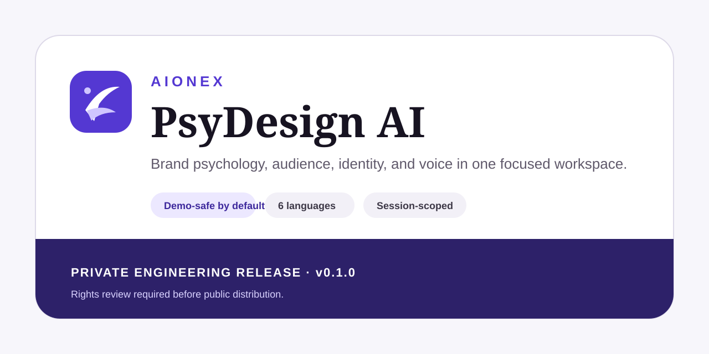
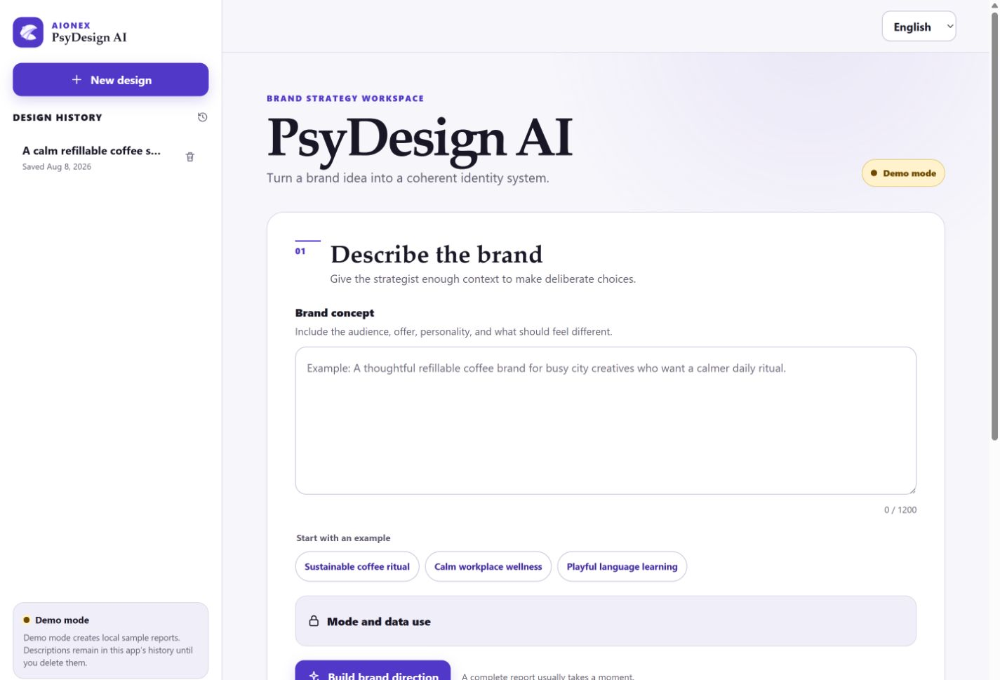
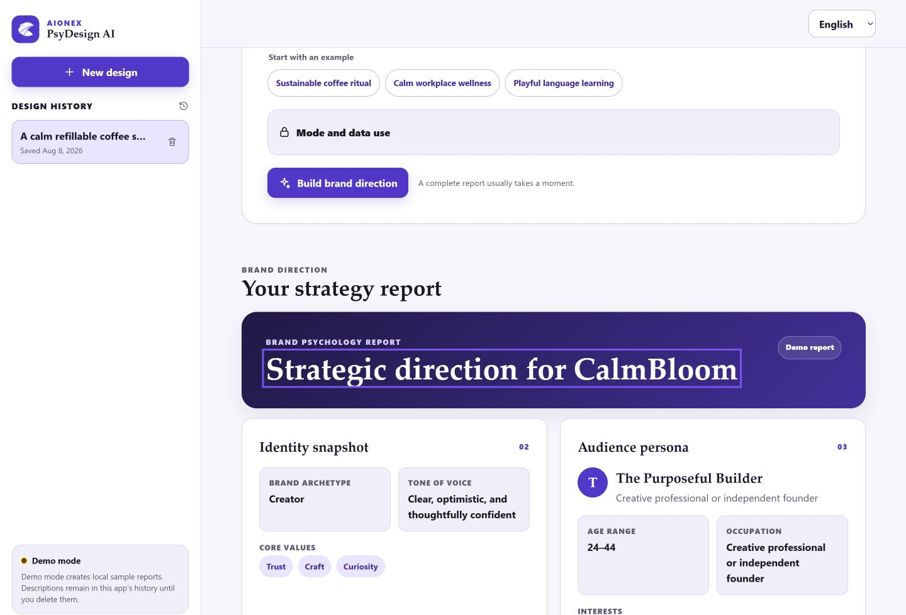
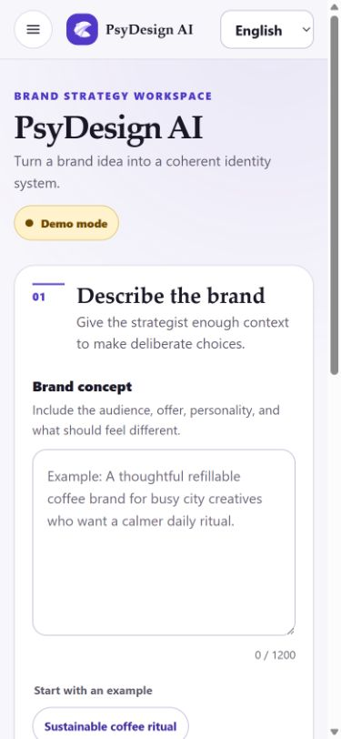
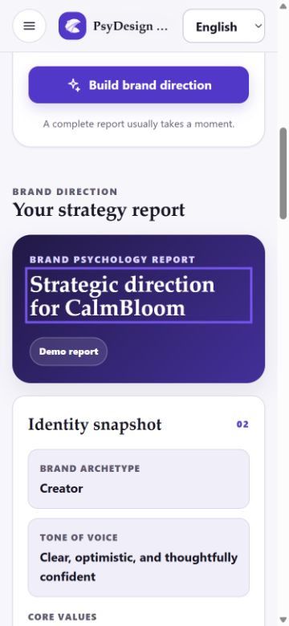
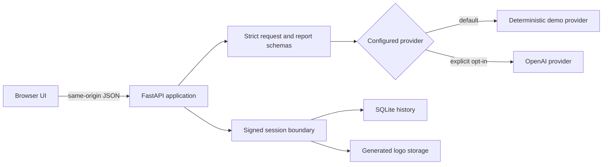

# PsyDesign AI

> Turn a brand idea into a structured, multilingual brand-psychology direction—locally in deterministic demo mode or through an explicitly configured AI provider.



PsyDesign AI is an AIONEX-branded product workspace for founders, marketers, designers, and small product teams. A short brand brief becomes a coherent report covering personality, audience, visual direction, naming, slogans, narrative, campaign direction, and an interactive brand persona.

This repository is currently **private and not cleared for public release**. The product is fully runnable for internal evaluation, but its first-party contribution chain must be resolved before any public distribution or licensing decision. See [Rights and release status](docs/RIGHTS_AND_RELEASE_STATUS.md).



## What it solves

Early brand work is often scattered across loose notes, subjective visual references, and disconnected naming exercises. PsyDesign AI turns one focused brief into a reviewable system:

- a brand archetype, tone of voice, and core values;
- a target-audience persona with interests and pain points;
- an original generated logo artifact and font direction;
- names, slogans, story, social bio, and campaign concept;
- a persona chat for testing how the proposed brand should sound; and
- session-scoped local history for revisiting, downloading, or deleting work.

The default demo provider is deterministic, fast, and offline. It makes product evaluation safe without an API key or paid request. OpenAI mode is opt-in and remains a live integration that must be verified by the operator in their own environment.

## Product experience

| Capability | Current status |
|---|---|
| Brand-direction generation | Implemented and tested in deterministic demo mode |
| Persona chat and speech controls | Implemented and tested in demo mode |
| Six UI languages | English, Spanish, French, Hindi, Chinese, and Arabic |
| RTL layout | Implemented and browser-verified for Arabic |
| Local history and logo download | Implemented with signed, session-scoped access |
| Responsive interface | Browser-verified at 375 px, 390 px, 667 px landscape, and 1440 px |
| OpenAI provider | Implemented behind explicit configuration; mocked in tests; no live provider call was made during this release |
| Public deployment | Not supported by this private evaluation release |

### Meaningful result



### Mobile behavior

| Mobile brief | Mobile result |
|---|---|
|  |  |

## Built for careful evaluation

- **Safe by default:** `PSYDESIGN_MODE=demo` makes no external AI request and requires no API key.
- **Explicit cost boundary:** OpenAI mode cannot be enabled without an API key and uses bounded request schemas plus route-specific rate limits.
- **Session isolation:** signed HttpOnly cookies scope history records and generated logos to one browser session.
- **Local asset control:** generated logos are copied into controlled local storage; arbitrary image proxying is not exposed.
- **Defensive rendering:** model- and user-controlled values are inserted with DOM text APIs rather than HTML injection.
- **Browser policy:** same-origin mutation checks, trusted-host handling, content-security policy, referrer policy, and other security headers are applied centrally.
- **Accessible interaction:** visible labels and focus states, a skip link, semantic live regions, keyboard-operable controls, Escape-to-close navigation, reduced-motion rules, and 44 px controls.
- **No frontend supply chain:** the shipped interface uses local SVG and system fonts, with no CDN script, remote font, or runtime icon library.

These controls reduce common risks; they are not a security certification. Review [Security model](docs/SECURITY_MODEL.md) and [known limitations](#known-limitations) before adapting the project.

## Architecture



The application factory in `psydesign/application.py` owns the HTTP boundary. Provider implementations return one validated `BrandReport`; persistence stores the validated report plus a controlled logo filename. The browser receives only same-origin logo routes bound to its signed session.

Read [Architecture](docs/ARCHITECTURE.md), [Technical deep dive](docs/TECHNICAL_DEEP_DIVE.md), and [decision records](docs/DECISIONS/README.md) for module-level detail and tradeoffs.

## Technology stack

| Layer | Technology |
|---|---|
| Web/API | Python 3.12, FastAPI 0.141.1, Uvicorn 0.52.1 |
| Validation | Pydantic through FastAPI, explicit nested schemas |
| Persistence | SQLAlchemy 2.0.51 and SQLite |
| AI adapter | OpenAI Python 2.53.0, opt-in only |
| UI | Server-rendered Jinja2, semantic HTML, CSS, and vanilla JavaScript |
| Quality | pytest, Ruff, mypy, Bandit, and pip-audit |

All direct dependencies are exactly pinned. The current transitive graph is recorded in the generated SBOM for this release, but the two requirements files are not a fully hashed lock.

## Project structure

```text
app.py                     ASGI entry point
psydesign/                 application, providers, schemas, storage, and security
templates/dashboard.html   semantic server-rendered shell
static/                    local CSS, JavaScript, and SVG mark
tests/test_backend.py       functional, isolation, validation, and provider tests
docs/                      architecture, security, flows, decisions, and evidence
.github/                   CI, security checks, templates, and dependency updates
```

Local databases, generated assets, caches, secrets, the virtual environment, and private audit/recovery material are ignored.

## Requirements

- Python 3.12
- Git for cloning
- Node.js only for the standalone JavaScript syntax check used by the development quality gate

The default demo requires no network access after dependencies are installed and no AI credential.

## Install

PowerShell:

```powershell
py -3.12 -m venv .venv
.\.venv\Scripts\Activate.ps1
python -m pip install --upgrade pip
python -m pip install -r requirements-dev.txt
```

macOS or Linux:

```bash
python3.12 -m venv .venv
source .venv/bin/activate
python -m pip install --upgrade pip
python -m pip install -r requirements-dev.txt
```

`requirements-dev.txt` includes the exact runtime pins as well as the test and audit tools. Use `requirements.txt` instead for a runtime-only environment.

## Run locally

Demo mode is the default; no `.env` file is needed:

```powershell
python app.py
```

Open `http://127.0.0.1:8000`. The server intentionally binds only to loopback when launched this way.

Health checks:

```powershell
Invoke-RestMethod http://127.0.0.1:8000/healthz
Invoke-RestMethod http://127.0.0.1:8000/api/status
```

### Configuration

Copy `.env.example` only when you need custom paths or explicit provider settings. The application does not silently load local environment files; pass one deliberately through Uvicorn:

```powershell
Copy-Item .env.example .env
python -m uvicorn app:app --host 127.0.0.1 --port 8000 --env-file .env
```

Important variables:

| Variable | Purpose | Default |
|---|---|---|
| `PSYDESIGN_MODE` | `demo` or explicit `openai` provider selection | `demo` |
| `OPENAI_API_KEY` | Server-side key required only for OpenAI mode | unset |
| `PSYDESIGN_DATABASE_PATH` | Local SQLite file | `./brand_history.db` |
| `PSYDESIGN_GENERATED_DIR` | Controlled generated-logo directory | `./data/generated` |
| `PSYDESIGN_SESSION_SECRET` | Optional 32+ character signing secret | generated locally when absent |
| `PSYDESIGN_COOKIE_SECURE` | Require HTTPS cookies in a TLS deployment | `false` |
| `PSYDESIGN_ALLOWED_HOSTS` | Comma-separated trusted hostnames | loopback hosts |
| `PSYDESIGN_*_RATE_LIMIT` | Per-client generation, chat, and TTS limits | see `.env.example` |

Never put a real key in source, screenshots, issues, logs, or commits. For OpenAI mode, export `OPENAI_API_KEY` server-side or provide it through a secret manager. OpenAI's [API authentication guidance](https://developers.openai.com/api/reference/overview#authentication) documents API keys as secrets and recommends loading them from an environment variable or key-management service.

## Usage

1. Describe the audience, offer, personality, and desired difference.
2. Build the brand direction and review each report section.
3. Download the controlled logo artifact if useful for private evaluation.
4. Ask the persona a message or positioning question.
5. Reopen or delete the report from design history.
6. Switch language at any time; Arabic activates RTL layout.

Generated names, logos, slogans, and claims require independent originality, trademark, factual, and legal review before use.

## HTTP surface

| Method and path | Purpose |
|---|---|
| `GET /` | Render the localized workspace |
| `GET /healthz` | Local readiness check |
| `GET /api/status` | Active mode and readiness |
| `POST /api/generate-brand` | Generate and save a validated report |
| `GET /api/history` | Read the current signed session's reports |
| `DELETE /api/history/{id}` | Delete the session-owned report and logo |
| `GET /api/history/{id}/logo` | Read a session-owned local logo |
| `POST /api/chat-with-persona` | Test a message against a complete report |
| `POST /api/tts` | Return bounded provider audio |

Interactive API documentation is deliberately disabled. See `psydesign/schemas.py` and the tests for the exact contracts.

## Quality checks

```powershell
python -m ruff check app.py psydesign tests
python -m ruff format --check app.py psydesign tests
python -m mypy app.py psydesign
python -m pytest -q
python -m bandit -q -r app.py psydesign
python -m pip_audit -r requirements.txt
node --check static/script.js
```

The release gate also starts the real local app, exercises the principal API and browser journeys, scans publishable content for credential patterns, and checks a fresh clone. See [Security policy](SECURITY.md) for responsible reporting.

## Privacy and data handling

- Demo mode processes the description locally and stores the report and logo in local application storage.
- OpenAI mode sends brand descriptions, report context, persona messages, and TTS text to the configured provider.
- History is separated by a signed pseudonymous browser-session cookie, not by an authenticated user account.
- No analytics or remote frontend resources are shipped.
- There is no automatic retention window or delete-all control; users delete individual reports from history.
- Deleted SQLite content is configured with `secure_delete`, but operators still control backups, filesystem snapshots, and cloud-sync history.

Do not expose the current build to untrusted users without adding real authentication, shared-store rate limits, an explicit retention policy, TLS, secure-cookie configuration, operational monitoring, and a deployment threat review.

## Known limitations

- The OpenAI integration is covered by mocked adapter tests but was not live-tested for this release.
- The in-memory limiter is per process and is not suitable for a horizontally scaled service.
- Signed sessions provide isolation, not identity, account recovery, or cross-device access.
- SQLite and local generated files target a single-instance local workflow.
- UI translations are maintained in application source; there is no external translation-management pipeline.
- The interface currently has a light theme only.
- The repository is private and rights-pending; no public deployment, package, or source license is authorized.

## Roadmap

The next responsible milestones are documented in [ROADMAP.md](ROADMAP.md): resolve contributor rights, complete a transitive lock and license bundle, add authenticated multi-user storage, introduce distributed controls for an internet deployment, and live-verify the optional provider behind an operator-owned test account.

## Documentation

- [Architecture](docs/ARCHITECTURE.md)
- [Technical deep dive](docs/TECHNICAL_DEEP_DIVE.md)
- [Security model](docs/SECURITY_MODEL.md)
- [User flows](docs/USER_FLOWS.md)
- [Case study](docs/CASE_STUDY.md)
- [Demo script](docs/DEMO_SCRIPT.md)
- [Client adaptation ideas](docs/CLIENT_ADAPTATION_IDEAS.md)
- [Decision records](docs/DECISIONS/README.md)
- [Rights and release status](docs/RIGHTS_AND_RELEASE_STATUS.md)
- [Third-party notices](THIRD_PARTY_NOTICES.md)

## Contributing and support

The project is not accepting general public contributions while ownership and release authority are unresolved. Authorized private collaborators should read [CONTRIBUTING.md](CONTRIBUTING.md) and preserve the security and rights gates.

Use this private repository's GitHub Issues for verified bug reports and GitHub Discussions for support or legitimate AIONEX product-engineering inquiries. No email address or public website is asserted here.

## License and release status

This repository is **not open source**. No project license, public distribution permission, or exclusive ownership claim is granted. Third-party packages remain under their own licenses. Read [LICENSE](LICENSE), [NOTICE.md](NOTICE.md), and [THIRD_PARTY_NOTICES.md](THIRD_PARTY_NOTICES.md) before any use beyond authorized private evaluation.

The AIONEX name is used as the product and maintainer identity for this private engineering release. That branding does not resolve the documented contribution chain or grant trademark rights.

---

**AIONEX product identity · PsyDesign AI v0.1.0 · private evaluation release**
