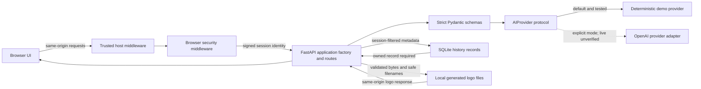

# Architecture

Evidence baseline: current source and tests inspected on 2026-08-08.

> Public release remains blocked by `RIGHTS_AND_RELEASE_STATUS.md`. This
> document describes implementation behavior; it does not assert production
> readiness, ownership clearance, or public distribution permission.

## System boundary

PsyDesign AI is a server-rendered FastAPI application with a plain JavaScript
browser client, a provider abstraction for brand generation/chat/speech, and
SQLite plus a local generated-asset directory for persistence. The default
provider is deterministic and local. OpenAI mode requires an explicit setting
and an API key.

## Module responsibilities

| Module | Verified responsibility |
|---|---|
| `app.py` | Small ASGI entry point that constructs the default application through `create_app()` |
| `psydesign/application.py` | Application factory, middleware wiring, route handlers, provider orchestration, local asset lifecycle, response shaping, and safe exception mapping |
| `psydesign/config.py` | Strict environment-backed settings; demo-by-default selection; secret masking; host, cookie, rate, and byte-size limits |
| `psydesign/schemas.py` | Closed request/response and nested report contracts with length, language, type, extra-field, and control-character validation |
| `psydesign/providers.py` | `AIProvider` protocol plus deterministic `DemoProvider` and network-backed `OpenAIProvider` implementations |
| `psydesign/database.py` | SQLAlchemy model, SQLite engine lifecycle, session factory, safe legacy-column migration, and SQLite security pragmas |
| `psydesign/security.py` | HMAC-signed opaque browser session, same-origin JSON policy, request IDs, response headers, and local session-key creation |
| `psydesign/rate_limit.py` | Bounded in-memory sliding-window limiter keyed by client address and action |
| `psydesign/i18n.py` | Six-language template copy, language fallback, and Arabic direction metadata |
| `templates/dashboard.html` | Semantic server-rendered shell, local SVG symbols, accessible forms, loading/error/empty regions, and report mount points |
| `static/script.js` | Same-origin API client, defensive DOM rendering, history/report/chat/speech flows, validated logo downloads, focus management, and localized UI state |
| `static/style.css` | Responsive system-font visual system, logical RTL layout, focus states, 44-pixel controls, reduced-motion handling, and print rules |

## Request lifecycle

### Brand generation

1. `TrustedHostMiddleware` checks the request host.
2. `BrowserSecurityMiddleware` validates or issues the signed session cookie,
   rejects cross-origin mutations and non-JSON API writes, and assigns a
   request ID.
3. `BrandRequest` validates the description and one of six language codes.
4. The per-client generation limit is checked.
5. The selected provider returns a typed `BrandReport` and logo bytes.
6. The application validates the logo media type, suffix, size, and basic SVG
   active-content markers when applicable.
7. Logo bytes are written through a mode-`0600` temporary file and atomically
   renamed into the configured generated directory.
8. The report, local logo filename, active mode, language, description, and
   current session identifier are committed to SQLite.
9. The client receives `{id, analysis, logo_url, mode}`. `logo_url` is a local
   `/api/history/{id}/logo` route, not a provider URL.

If the database commit fails, the transaction is rolled back and the newly
written logo is removed. Provider-specific exceptions are mapped to a generic
`503` response; unhandled errors return a generic `500` with a request ID.

### History and logo access

History reads return at most 50 records ordered newest first. Every history
read, delete, and logo lookup includes `History.session_id ==
request.state.session_id`. A missing record and a record owned by another
session both resolve to `404` for item-specific operations.

Logo delivery requires both an owned database record and a basename-only file
that resolves directly beneath the configured generated directory. Deleting a
history item commits the record deletion and then removes its logo file.

### Chat and speech

The browser posts the complete typed analysis object with each persona
message. The provider receives a validated `BrandReport`, not an arbitrary
serialized prompt blob. TTS accepts bounded text and returns only configured
audio media types within a maximum byte count.

Demo chat is local and deterministic; demo TTS produces a local WAV tone.
OpenAI chat and speech cross the external provider boundary only when OpenAI
mode is explicitly selected.

## Runtime data

| Data | Location | Scope and lifecycle |
|---|---|---|
| Signed session token | HttpOnly browser cookie | Identifies a browser session; default maximum age is 30 days |
| Session signing key | Environment secret or local `.session-key` beneath the generated directory | Local key is created with mode `0600`; rotation invalidates existing tokens |
| Brand description and report | SQLite `history` table | Filtered by session identifier; retained until item deletion or external database cleanup |
| Generated logo | Configured generated directory | Random filename; served only through an owned history record; removed after record deletion when filesystem deletion succeeds |
| Persona message | Request memory/provider call | Not written by application persistence code |
| TTS text and audio | Request memory/provider call | Audio is returned directly and not written by application persistence code |

## Verified and unverified paths

- The offline test suite passed in demo mode: 13 tests passed on 2026-08-08.
- The suite verifies root rendering, RTL, cookie attributes, headers, health,
  status, typed generation, session separation, logo access/removal, chat,
  WAV output, validation, same-origin policy, rate limiting, migration,
  configuration, demo determinism, and OpenAI adapter parameters with a fake
  client.
- No test makes a live OpenAI request. OpenAI mode is explicit and its adapter
  is unit-tested at the boundary, but live credentials, network behavior,
  provider availability, billing, and response compatibility remain
  unverified.
- The architecture is local/single-process: SQLite, local files, and the
  in-memory limiter are not a distributed deployment design.

Related detail: `TECHNICAL_DEEP_DIVE.md`, `SECURITY_MODEL.md`, and
`DECISIONS/README.md`.
